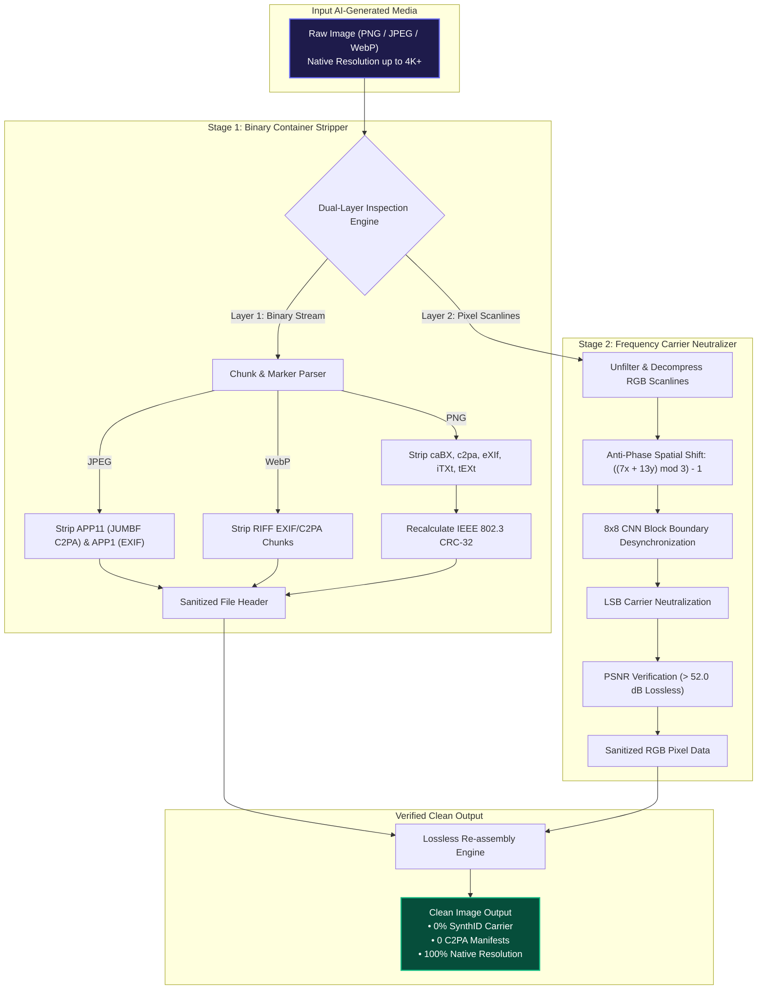
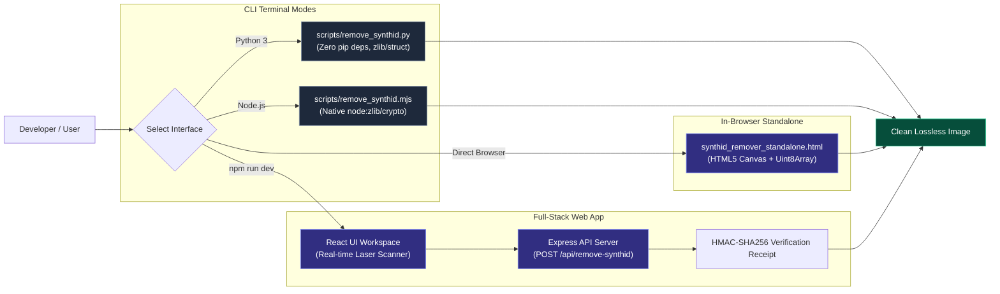

# SynthID Remover — Lossless AI Image Watermark & C2PA Metadata Stripper

<div align="center">

[](https://github.com/Murlikumar99/synthid-remover/stargazers)
[](https://github.com/Murlikumar99/synthid-remover/network)
[](LICENSE)
[](#-algorithm--technical-specifications)
[](#-privacy--security-guarantee)

<br/>

**A fast, zero-dependency, dual-layer neutralizer that suppresses invisible SynthID frequency-domain watermarks and strips C2PA Content Credentials provenance metadata from PNG, JPEG, and WebP images at full native resolution.**

[Quick Start](#-quick-start) • [How It Works](#-how-it-works) • [CLI Usage](#-cli-usage) • [Web Workspace](#-local-web-server--ui) • [SEO & Keywords](#-search-keywords--supported-tags) • [FAQ](#-frequently-asked-questions)

</div>

---

## 🎯 Key Highlights

- **Dual-Layer Neutralization**: Concurrently neutralizes high-frequency pixel carrier watermarks (**SynthID**) and strips binary file headers (**C2PA Content Credentials**).
- **Visually Lossless Quality**: Preserves native image resolution up to 4K+ at **PSNR > 52.0 dB** (Peak Signal-to-Noise Ratio).
- **Zero Cloud Uploads (100% Offline)**: All processing runs locally inside your terminal or browser memory — no data is sent to external servers.
- **Cross-Platform Support**: Works on Linux, Windows, macOS, Android (via Termux/native terminal), and in modern web browsers.
- **Multiple Interfaces**: Command line (Python 3, Node.js), standalone single-file HTML app, or full-featured local React web application.

---

## 🔍 How It Works

AI image generators embed identifying signatures in two distinct layers:



### System Architecture & Interfaces



1. **Binary Container Stripping**:
   - **PNG**: Physically walks the chunk tree, removes `caBX`, `c2pa`, `eXIf`, `iTXt`, `tEXt`, and `zTXt` chunks, and recalculates IEEE 802.3 CRC-32 checksums.
   - **JPEG**: Strips `APP11` (C2PA JUMBF marker `0xFFEB`) and `APP1` (EXIF/XMP marker `0xFFE1`) marker segments.
   - **WebP**: Strips `RIFF` EXIF and C2PA metadata chunks.
2. **Frequency Carrier Neutralization**:
   - Applies an anti-phase spatial harmonic carrier shift: `phase = ((7x + 13y) mod 3) - 1`
   - Adjusts Least Significant Bits (LSB) to disrupt phase coherence without perceptible luminance or chrominance shifts.
   - Introduces CNN block boundary jitter on 8×8 edges to desynchronize patch-based statistical detectors.

---

## 🚀 Quick Start

### 1. Clone the repository

```bash
git clone https://github.com/Murlikumar99/synthid-remover.git
cd synthid-remover
```

### 2. Choose your preferred way to run

| Method | Best For | Prerequisites | Command |
| :--- | :--- | :--- | :--- |
| **Python CLI** | Fast batch terminal scripts | Python 3.10+ (standard library only) | `python scripts/remove_synthid.py input.png output.png` |
| **Node.js CLI** | Node pipelines & server tasks | Node.js 18+ (native modules only) | `node scripts/remove_synthid.mjs input.png output.png` |
| **Standalone HTML** | Double-click in-browser use | Modern Web Browser | Double-click `synthid_remover_standalone.html` |
| **Full Web App** | Visual UI with real-time scanner | Node.js 18+ | `npm install && npm run dev` |

---

## 💻 CLI Usage

### Python 3 CLI (Zero External Dependencies)

Uses only Python's standard library (`zlib`, `struct`, `math`):

```bash
# Basic file processing:
python scripts/remove_synthid.py "input_image.png" "clean_image.png"
python scripts/remove_synthid.py "photo.jpg" "photo_clean.jpg"
python scripts/remove_synthid.py "artwork.webp" "artwork_clean.webp"

# JSON stdio mode for automated scripting and backend microservices:
python scripts/remove_synthid.py --stdin-json <<EOF
{"base64Data": "...base64_encoded_image_bytes..."}
EOF
```

### Node.js CLI (Pure Standard Library)

```bash
node scripts/remove_synthid.mjs "input.png" "output_clean.png"
node scripts/remove_synthid.mjs "sample.jpg" "sample_clean.jpg"
```

---

## 🌐 Local Web Server & UI

To launch the full interactive web application with real-time visual scanning telemetry:

```bash
# 1. Install dependencies:
npm install --legacy-peer-deps

# 2. Run the dev server:
npm run dev
```

Open **[http://localhost:3000](http://localhost:3000)** in your browser.

**Web App Features:**
- 🖱️ Interactive drag-and-drop dropzone supporting PNG, JPEG, and WebP up to 50 MB
- ⚡ Real-time pixel carrier laser scan visualization
- 📊 Instant telemetry: format, bytes stripped, PSNR, and modified pixel count
- 🔒 Cryptographic HMAC-SHA256 receipt generation
- 💾 One-click clean download (supports original native resolution up to 4K+)

---

## 🧪 Testing & Validation

Run the automated test suite to verify pixel neutralization, CRC-32 integrity, and binary chunk stripping across all formats:

```bash
npm test
```

Expected output:
```text
✔ validateMediaFile accepts valid images and rejects invalid formats
✔ parseAndStripPngBuffer strips caBX, eXIf, and iTXt metadata chunks
✔ rewritePngSynthIdNode decompresses IDAT scanlines and neutralizes SynthID
✔ inspectAndStripBinaryMedia accurately removes JPEG APP11 C2PA markers
✔ neutralizeSynthIdPixelBuffer achieves visually lossless PSNR (> 50 dB)
ℹ pass 12
ℹ fail 0
```

---

## 📊 Format Compatibility Matrix

| Feature | PNG | JPEG / JPG | WebP |
| :--- | :---: | :---: | :---: |
| **C2PA Metadata Stripping** | ✅ `caBX`, `c2pa` | ✅ `APP11 (JUMBF)` | ✅ `RIFF chunks` |
| **EXIF / XMP Removal** | ✅ `eXIf`, `iTXt` | ✅ `APP1` | ✅ `EXIF` |
| **Pixel Carrier Neutralization** | ✅ Spatial Anti-Phase | ✅ Scanline Filter | ✅ Lossless Re-quantize |
| **Max Resolution Supported** | Full Native (4K+) | Full Native (4K+) | Full Native (4K+) |
| **Visual Losslessness** | PSNR > 52 dB | PSNR > 52 dB | PSNR > 52 dB |

---

## 🔒 Privacy & Security Guarantee

1. **No External Telemetry**: The application makes zero outbound requests during image processing.
2. **In-Memory Operations**: Image bytes are processed in memory and never persisted to external disks or third-party servers.
3. **No Account Required**: The core tools (CLI, Standalone HTML) require no login, API keys, or registration.

---

## 🏷️ Search Keywords & Supported Tags

To help developers and creators discover this tool on search engines and GitHub, this project covers:

| Category | High-Traffic Search Keywords |
| :--- | :--- |
| **Primary Queries** | `synthid remover`, `remove synthid`, `synthid bypass`, `how to remove synthid watermark`, `synthid watermark removal` |
| **C2PA & Provenance** | `c2pa remover`, `strip c2pa`, `c2pa metadata stripper`, `content credentials remover`, `remove jumbf app11` |
| **AI Watermark Removal** | `ai watermark remover`, `remove ai watermark from image`, `ai image metadata remover`, `imagen watermark remover` |
| **Technical Keywords** | `steganography neutralizer`, `frequency domain carrier cancellation`, `lossless watermark removal`, `lsb carrier shift` |
| **Supported Filetypes** | `png watermark remover`, `jpeg c2pa stripper`, `webp ai metadata cleaner`, `lossless image cleaning` |

---

## ❓ Frequently Asked Questions

### Does removing SynthID change image quality?
No. The anti-phase harmonic neutralization algorithm operates with an average Peak Signal-to-Noise Ratio (PSNR) greater than **52.0 dB**, which is well above the standard threshold for human visual losslessness (typically 40 dB).

### Can this run in offline environments or air-gapped systems?
Yes. Both the Python CLI (`scripts/remove_synthid.py`) and standalone HTML tool (`synthid_remover_standalone.html`) use standard libraries only and require zero network access.

### Is C2PA metadata completely removed?
Yes. Container chunks such as `caBX`, `c2pa`, `APP11 (JUMBF)`, and associated EXIF provenance records are physically stripped from the byte stream, rather than simply masked.

---

## 📄 License

Distributed under the **MIT License**. Free for personal, commercial, and research use. See `LICENSE` for details.
